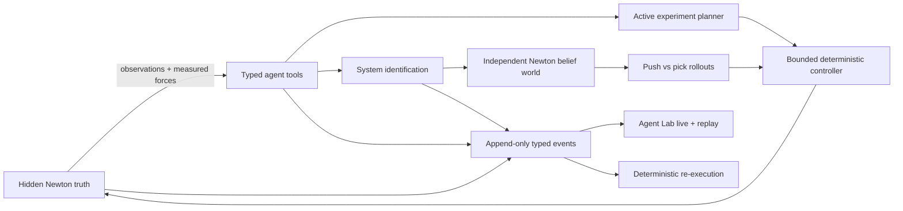

# Curious Robot

**Discover Physics. Simulate. Act. Learn.**

Curious Robot is an open-source, simulation-only research vertical slice for
active physical system identification and autonomous manipulation. A Franka
Panda agent observes an unknown cube, chooses bounded experiments, derives
contact-gated physical constraints relevant to its task, calibrates a separate belief simulation,
compares push and pick-and-place candidates, executes the selected action in a
hidden truth simulation, and explains the result.

The truth and belief environments are independent NVIDIA Newton simulations.
Ground-truth mass and friction are owned by the evaluation harness and cannot
be accessed through the robot's observation or planning interfaces.

The design intent is to make the *discovery itself* the product. Agent Lab
synchronizes the Newton-driven scene, current discovery phase, measured
evidence, belief updates, and telemetry. The headless CLI remains available for
research runs and CI.

> The browser is a presentation mirror. Newton/MuJoCo Warp remains the only
> physics authority; React Three Fiber never simulates contacts or dynamics.
> Its FR3 visuals are converted from Franka Robotics' official Apache-2.0
> [`franka_description`](https://github.com/frankarobotics/franka_description)
> meshes at pinned commit `d9841cf`; Newton body transforms remain authoritative.




[Watch the MP4 demo](docs/media/curious-robot-demo.mp4) · generated from the same replay reducer with a fixed capture clock.

## Choose an experience

| Mode | Use it for | What you see |
| --- | --- | --- |
| **Agent Lab** | The primary local demo and investigation workspace | Live Newton mirror, six-phase progress, evidence feed, telemetry, controls, and synchronized replay |
| **Headless run** | Research automation, CI, or environments without a browser | Structured CLI stages and the complete artifact directory |
| **Replay** | Reviewing a completed run without advancing its original physics | The same Agent Lab reducer for synchronized evidence, or Newton's independent visual recording |
| **Re-execution** | Testing numerical reproducibility | A fresh physics computation compared with the recorded trajectory and explicit tolerances |

## Agent Lab quick start

Requirements: Linux, Python 3.12 or 3.13, Node.js 22 with Corepack, and an
NVIDIA R580+ driver for the default Warp build. CPU execution is also supported
for tests.

```bash
uv sync --extra dev --extra web
corepack pnpm --dir src/web install --frozen-lockfile
corepack pnpm --dir src/web build
uv run curious-robot web --open
```

The browser opens the New Run screen without starting GPU work. Select **Run
discovery demo** for the versioned seed/profile preset, or expand **Configure
run** to set the seed, device, cube-mass bounds, randomized surface family,
evaluator reveal, and recording options. For a scripted local demonstration:

```bash
uv run curious-robot web --open --autorun --seed 7 --device cuda:0
```

Agent Lab is an evidence workspace, not a chat façade. Its top rail shows six
macro phases—Observe, Discover, Experiment, Calibrate, Decide, Execute—while
the active phase names the precise repeated substep. The evidence feed exposes
typed tool calls, measurements, bounded rationale, posterior deltas,
predictions, and verification. It never presents private chain-of-thought.

## Headless run

```bash
uv sync --extra dev
uv run curious-robot run --seed 7 --device cuda:0 --output artifacts/demo
```

CI runs the deterministic planning/SysID/schema suite on CPU. GPU-tagged tests
exercise Newton/MuJoCo Warp contact and run locally on NVIDIA hardware.

Use `--device cpu` for a portable run. The run creates structured decisions,
measurements, belief history, replay state, parameter and trajectory plots,
and a final result summary under the output directory.

### Isolated friction capability

The first explicit Real-to-Sim-to-Real slice runs Reality, learned Twin, and
terminal Evaluator in three spawned processes. Reality privately retains one
sampled scenario, destroys the experiment world, and allocates a fresh world
before deploying the Twin-validated push policy:

```bash
CURIOUS_ROBOT_EVALUATOR_SCENARIO_SEED=7 \
  uv run curious-robot lab-friction \
  --seed 7 --device cuda:0 --output artifacts/lab-friction
```

Inspect `friction_capability_report.md` for the concise result and process/world
isolation evidence. `friction_capability_manifest.json` contains the complete
content-addressed artifact chain. These two root-level files are trusted-user
terminal reports, not agent inputs; the full evaluator artifact remains under
its separate CAS authority. The private seed override is for evaluator
reproducibility; the trusted launcher delivers it only to Reality, scrubs it
from every child environment, and never serializes it to an agent artifact.

After a successful terminal evaluation, distill the run into a reusable,
content-addressed deterministic capability:

```bash
uv run curious-robot lab-distill --run artifacts/lab-friction
```

The capability records its validated target, sensor-derived initial-pose tolerance and workspace, force/speed/attempt
bounds, and recovery exits. Nominal decisions require no LLM; a missing
operation, out-of-envelope request, safety trip, controller failure, or exhausted
recovery bound returns control to the agent.

Run the distilled capability through the same independent Reality-side
guardrail:

```bash
CURIOUS_ROBOT_EVALUATOR_SCENARIO_SEED=7 \
  uv run curious-robot lab-execute-skill \
  --run artifacts/lab-friction --seed 7 --device cuda:0
```

Reality reloads and verifies the CapabilityArtifact, attestation, source
deployment, policy, exact target/radius, protocol, and safety limits before it
sends any robot command. The result is written to `skill_execution.json`.

During a run the CLI emits stages such as `REASON`, `ACT / MEASURE`, `LEARN`,
`PREDICT`, and `VERIFY`. Open `artifacts/demo/discovery_timeline.html` for the
legacy static evidence trail, or view `artifacts/demo/discovery.gif`.

## Demo and replay

Agent Lab live and replay modes consume the same ordered event model and pure
frontend reducer. Selecting a stage or evidence item seeks the corresponding
Newton frame and telemetry cursor. The separate Newton ViewerFile remains an
independent scientific diagnostic.

Each headless run generates:

- `discovery.gif` — animated prior-to-posterior parameter discovery;
- `discovery_timeline.html` — inspectable belief and tool-call timeline;
- `scene_replay.bin` — Newton visual replay with pause, seek, and frame step;
- `reexecution.json` — deterministic physics re-execution manifest;
- `estimated_vs_true.png`, `predicted_vs_observed.png`, `final_result.png`;
- `measurements.csv`, `decision_timeline.json`, and environment metadata.
- `experiment_protocol.json` — the versioned procedure chosen before the run;
- `belief_simulation_config.json` — learned posterior values passed to the independent belief world;
- `value_provenance.json` — machine-readable ownership and dataflow for constants, config, learned values, and evaluator-only truth.

```bash
# Official Newton state playback; the CLI prints the supported viewer command.
uv run curious-robot-replay --visual artifacts/demo/scene_replay.bin

# Rebuild physics and compare the result numerically.
uv run curious-robot-replay artifacts/demo/reexecution.json --verify
```

Visual playback and deterministic re-execution are deliberately different:
playback seeks recorded states, while re-execution reconstructs the environment
and applies the recorded action trace. See
[`docs/reproducibility.md`](docs/reproducibility.md) for tolerances and the
nondeterminism boundary.

## Reproducible demo media

The portfolio video records the complete Agent Lab composition—not just the 3D
viewport—from a terminal event log on a fixed 30 fps replay clock:

```bash
scripts/record_agent_lab_demo.sh \
  --run artifacts/<run_id> \
  --output docs/media/curious-robot-demo.mp4
```

The capture waits for the event reducer, telemetry, and R3F frame barrier. It
fails instead of publishing a missing/blank WebGL view, validates the encoded
resolution, rate, and duration, and writes a SHA-256 sidecar. Commit the small
GIF preview; attach the MP4 and full run evidence to a versioned GitHub Release.
The exact media contract and five required discovery moments are documented in
[`docs/media/README.md`](docs/media/README.md).

## Verify the project

```bash
uv run pytest
corepack pnpm --dir src/web typecheck
corepack pnpm --dir src/web test
corepack pnpm --dir src/web build
```

## Honest scope

This repository demonstrates simulated-real → system identification → belief
simulation → action planning → simulated-real. It does **not** claim a hardware
experiment. MuJoCo Warp contact is treated as non-differentiable here; physics
calibration therefore uses bounded SciPy optimization. The current force
producer is Newton `SensorContact` over native MuJoCo Warp robot-tool ↔ cube
contacts. It measures linear contact force, not a complete strain-gauge wrist
moment, and never reads hidden object parameters.

The validated MVP manipulation path is physical robot pushing. Pick-and-place
and quasi-static weighing remain visible candidates but are rejected until a
bilateral finger-contact lift passes its acceptance gate; the system does not
substitute a weld, teleport, or direct cube-force surrogate.

Executed evidence is available as the
[`physical experiment report`](docs/evidence/physical-experiment-report.md),
the exact [`experiment protocol`](docs/evidence/physical-experiment-protocol.json),
and the posterior-only
[`belief simulation config`](docs/evidence/physical-belief-simulation-config.json).
Their machine-readable ownership chain is captured in
[`physical-value-provenance.json`](docs/evidence/physical-value-provenance.json).
The reference joint-command trace also passes a fresh-world
[`physics re-execution check`](docs/evidence/reference-reexecution-report.json)
within its declared 15 mm tolerance.

The randomized surface and cube define one contact pair. From that interaction
the agent infers **bounded effective cube–surface static and dynamic friction**; it
does not claim to identify separate intrinsic cube and table coefficients from
unidentifiable evidence.

See [`docs/architecture.md`](docs/architecture.md),
[`docs/capabilities.json`](docs/capabilities.json), the approved
[`Agent Lab design`](docs/designs/agent-lab-ui.md), and
[`DESIGN.md`](DESIGN.md) for boundaries, evidence, and UI decisions. The
executed requirement mapping and honest replay result are in the
[`Agent Lab goal audit`](docs/agent-lab-goal-audit.md).

The official Franka visual asset provenance, per-link bounds, and SHA-256 are
recorded in `src/web/public/models/franka/manifest.json`; regenerate them with
`uv run python scripts/export_franka_visuals.py`.
