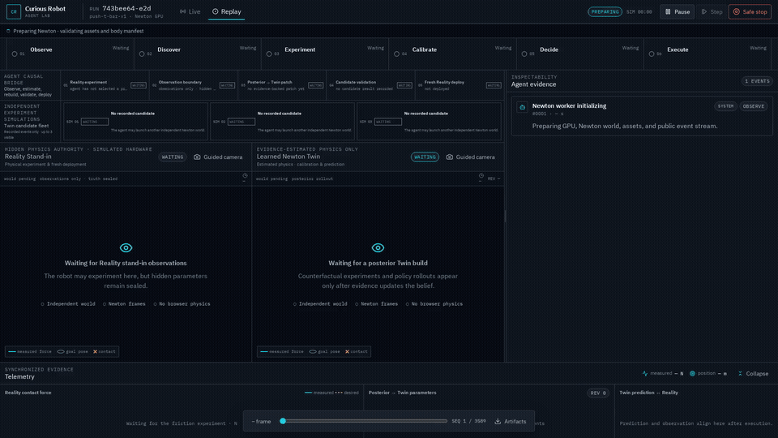
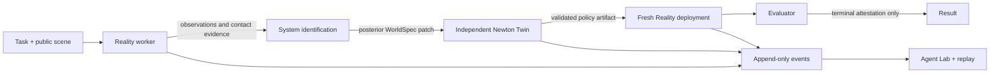

# Curious Robot

**Discover Physics. Simulate. Act. Learn.**

[](https://github.com/yujeongdev/curious-robot/actions/workflows/ci.yml)
[](https://www.python.org/)
[](LICENSE)

Curious Robot is a simulation-only research system for autonomous physical
discovery and manipulation. A Franka robot selects bounded experiments,
measures contact and motion, estimates task-relevant physical parameters,
builds an independent NVIDIA Newton twin, validates a policy, and deploys it
into a fresh simulated-reality episode.

The project keeps three authorities separate:

- **Reality** owns hidden episode parameters and produces observations.
- **Twin** is built only from public geometry, numerical configuration, and
  evidence-backed posterior parameters.
- **Evaluator** can inspect terminal truth but cannot provide inputs to the
  agent or Twin.

The validated simulation tasks are friction-aware pushing of an unknown cube
and pose-constrained pushing of a known-geometry T-bar onto the same T-shaped
floor silhouette from a bounded randomized start pose, with unknown effective
mass and friction. Pick-and-place,
weighing, T-bar capability distillation, and hardware execution remain
fail-closed until their physical acceptance gates pass.



[Watch the H.264 demo and inspect its checksum](https://github.com/yujeongdev/curious-robot/releases/tag/v0.2.2).

## What this repository demonstrates

- NVIDIA Newton 1.7 and Warp 1.18 with `SolverMuJoCo` / MuJoCo Warp
- native robot-tool ↔ object contact through `CONTACT_F` and `SensorContact`
- contact-valid static and dynamic friction experiments
- uncertainty-aware system identification with explicit mismatch reporting
- independent Reality, learned Twin, and Evaluator worker processes
- content-addressed evidence and policy lineage
- task-level experiment selection using information gain, cost, and risk
- versioned cube/T-bar task and public-geometry catalogs
- three independent T-bar Twin candidates followed by fresh-Reality deployment
- observed-yaw correction and adaptive public-face recovery pushes for randomized T-bar starts
- live and replayable dual-world Agent Lab that separates Reality experiments
  and deployment from learned-Twin calibration and prediction
- visual playback and numerical physics re-execution as separate modes
- bounded hardware interfaces that reject unsupported deployment

## Architecture



The browser is a presentation mirror. React Three Fiber never advances physics.
The Franka visuals come from Franka Robotics'
[`franka_description`](https://github.com/frankarobotics/franka_description)
at pinned commit `d9841cf`; provenance and hashes are recorded in the model
manifest.

See [Architecture](docs/architecture.md) for authority, artifact, and data-flow
details.

## Requirements

- Linux
- Python 3.12 or 3.13
- [`uv`](https://docs.astral.sh/uv/)
- Node.js 22 with Corepack for frontend development
- NVIDIA GPU and a compatible driver for the default CUDA path

CPU execution is supported for the deterministic unit and API test suites.

## Quick start

```bash
uv sync --extra dev --extra web
corepack pnpm --dir src/web install --frozen-lockfile
corepack pnpm --dir src/web build
uv run curious-robot web --open
```

The server binds to `127.0.0.1` by default. Agent Lab is a local research tool,
not an authenticated multi-user service; do not expose it to an untrusted
network.

Run the scripted local demonstration:

```bash
uv run curious-robot web --open --autorun \
  --task push-t-bar-v1 --seed 7 --device cuda:0
```

## Headless workflows

### Autonomous discovery episode

```bash
uv run curious-robot run \
  --task push-t-bar-v1 \
  --seed 7 --device cuda:0 --output artifacts/tbar-demo
```

### Isolated Reality → Twin → Reality capability

```bash
CURIOUS_ROBOT_EVALUATOR_SCENARIO_SEED=7 \
uv run curious-robot lab-friction \
  --task push-t-bar-v1 \
  --seed 7 --device cuda:0 --output artifacts/lab-tbar
```

The evaluator seed override is only for reproducible local evaluation. The
launcher delivers it to Reality, scrubs it from child environments, and does
not serialize it into agent-visible artifacts.

Distill and execute the validated **cube** capability. T-bar distillation is
intentionally rejected until its geometry-aware hardware envelope is validated:

```bash
CURIOUS_ROBOT_EVALUATOR_SCENARIO_SEED=7 \
uv run curious-robot lab-friction \
  --task push-cube-v1 \
  --seed 7 --device cuda:0 --output artifacts/lab-cube

uv run curious-robot lab-distill --run artifacts/lab-cube

CURIOUS_ROBOT_EVALUATOR_SCENARIO_SEED=7 \
uv run curious-robot lab-execute-skill \
  --run artifacts/lab-cube --seed 7 --device cuda:0
```

## Replay

Visual replay seeks recorded Newton states without recomputing physics:

```bash
uv run curious-robot-replay --visual artifacts/demo/scene_replay.bin
```

Physics re-execution creates a fresh world, reapplies recorded joint targets,
and compares trajectories with explicit tolerances:

```bash
uv run curious-robot-replay artifacts/demo/reexecution.json --verify
```

See [Reproducibility](docs/reproducibility.md) for the determinism boundary.

## Evidence

A run records the experiment protocol, raw measurements, belief history,
resolved world configuration, controller trace, predictions, and verification
result. In the process-isolated laboratory path, hidden values remain under
Reality/Evaluator authority. The legacy integrated Agent Lab runner writes
them only to a post-run trusted re-execution manifest; agent tools, events,
Twin inputs, and the browser never receive that manifest.

The repository includes a compact reference set:

- [isolated friction capability report](docs/evidence/friction-capability-report.md)
- [T-bar Twin-fleet acceptance report](docs/evidence/tbar-capability-report.md)

The executable protocol is versioned in
[`physical_experiments.json`](src/curious_robot/configs/physical_experiments.json).
Complete per-run manifests remain generated artifacts rather than curated source.

Generated run directories stay under ignored `artifacts/`. Full media belongs
in GitHub Releases; Git tracks only the small GIF preview and selected figures.

## Verification

```bash
uv run ruff check src tests
uv run pytest -m "not gpu"

corepack pnpm --dir src/web lint
corepack pnpm --dir src/web typecheck
corepack pnpm --dir src/web test
corepack pnpm --dir src/web build
```

GPU-marked tests exercise native Newton contact and full episodes on supported
NVIDIA workstations:

```bash
uv run pytest -m gpu
```

## Scope and limitations

- This repository reports simulated-real experiments, not physical-robot trials.
- The validated public sensor provides linear contact force, not a complete
  strain-gauge wrist wrench.
- Static and dynamic estimates are effective object–surface interaction values;
  one contact pair cannot identify intrinsic material coefficients separately.
- Mass remains a prior when the grasp/lift experiment is unavailable.
- MuJoCo Warp contact calibration uses black-box optimization; no end-to-end
  differentiable-contact claim is made.
- Hardware backends are interfaces and guarded planning paths, not evidence of
  a completed hardware deployment.

See [Validation](docs/validation.md) for executed evidence and known gaps, and
[Roadmap](docs/roadmap.md) for the off-center-mass and hardware extensions.

## Contributing and security

Read [CONTRIBUTING.md](CONTRIBUTING.md) before opening a change. Security and
private-disclosure guidance is in [SECURITY.md](SECURITY.md).

Curious Robot is released under the [Apache License 2.0](LICENSE). If this
project supports academic work, cite the metadata in [CITATION.cff](CITATION.cff).
