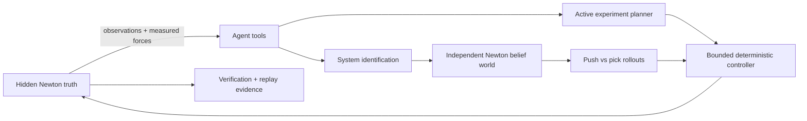

# Curious Robot

**Discover Physics. Simulate. Act. Learn.**

Curious Robot is an open-source, simulation-only research vertical slice for
active physical system identification and autonomous manipulation. A Franka
Panda agent observes an unknown cube, chooses bounded experiments, estimates
the parameters relevant to its task, calibrates a separate belief simulation,
compares push and pick-and-place candidates, executes the selected action in a
hidden truth simulation, and explains the result.

The truth and belief environments are independent NVIDIA Newton simulations.
Ground-truth mass and friction are owned by the evaluation harness and cannot
be accessed through the robot's observation or planning interfaces.

The design intent is to make the *discovery itself* the product. A successful
run should be understandable without reading source: the CLI narrates every
experiment and belief update, while an HTML timeline, plots, GIF, measurements,
and replay preserve the evidence behind the final manipulation.



## Quick start

Requirements: Linux, Python 3.12 or 3.13, and an NVIDIA R580+ driver for the
default Warp build. CPU execution is also supported for tests.

```bash
uv sync --extra dev
uv run curious-robot run --seed 7 --device cuda:0 --output artifacts/demo
uv run curious-robot-replay artifacts/demo/reexecution.json --verify
uv run pytest
```

Use `--device cpu` for a portable run. The run creates structured decisions,
measurements, belief history, replay state, parameter and trajectory plots,
and a final result summary under the output directory.

During a run the CLI emits stages such as `REASON`, `ACT / MEASURE`, `LEARN`,
`PREDICT`, and `VERIFY`. Open `artifacts/demo/discovery_timeline.html` for the
visual evidence trail, or view the generated `artifacts/demo/discovery.gif`.

## Demo and replay

Each run generates rather than checks in a stale demo:

- `discovery.gif` — animated prior-to-posterior parameter discovery;
- `discovery_timeline.html` — inspectable belief and tool-call timeline;
- `scene_replay.bin` — Newton visual replay with pause, seek, and frame step;
- `reexecution.json` — deterministic physics re-execution manifest;
- `estimated_vs_true.png`, `predicted_vs_observed.png`, `final_result.png`;
- `measurements.csv`, `decision_timeline.json`, and environment metadata.

```bash
uv run curious-robot-replay --visual artifacts/demo/scene_replay.bin
uv run curious-robot-replay artifacts/demo/reexecution.json --verify
```

For a portfolio video, capture the Newton replay beside
`discovery_timeline.html`; the generated GIF is the lightweight README preview
until a narrated full-scene recording is added under `docs/media/`.

## Honest scope

This repository demonstrates simulated-real → system identification → belief
simulation → action planning → simulated-real. It does **not** claim a hardware
experiment. MuJoCo Warp contact is treated as non-differentiable here; physics
calibration therefore uses bounded SciPy optimization. The wrist wrench is a
documented virtual sensor derived from the bounded actuator/contact force path,
not a readout of hidden object parameters.

See `docs/architecture.md`, `docs/capabilities.json`, and
`docs/reproducibility.md` for boundaries and evidence.
