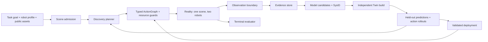

# 실험으로 Twin의 물리 모델을 선택하는 구조

> 인접 문서: [구현 계획](../plans/2026-10-24-autonomous-physics-discovery-and-bowling.md) · [외부 근거](../research/simready-bowling-and-model-discovery-2026.md) · [Architecture](../architecture.md) · [Agent Lab](../agent-lab.md)

2026-10-24 작성. 범위: 시뮬레이션 셋업, 씬 제약, 두 로봇, 관측·SysID·모델 선택의 소유권과 확장 계약.
기준: `e56d6b3b95b2fb037be664027c62bcabc530edfe`, Newton `1.7.0`; 상태: 설계 제안.

## 1. 현재 기반과 실제 빈칸

아래는 기준 커밋을 직접 확인한 내용이다. 예정 기능을 구현된 것으로 간주하지 않는다.

| 현재 코드 | 확인한 기능과 제한 | 이번 확장 |
| --- | --- | --- |
| [lab/ports.py](../../src/curious_robot/lab/ports.py) | Reality/Twin/Evaluator 및 process/world/model/state/config 분리 | 동일 경계 유지 |
| [lab/contracts.py](../../src/curious_robot/lab/contracts.py) | immutable artifact, WorldSpec, 증거를 요구하는 patch | 새 typed payload를 기존 store에 저장 |
| [lab/friction_capability.py](../../src/curious_robot/lab/friction_capability.py) | 실험→posterior→Twin→검증→fresh deployment | bounded iteration으로 확장 |
| [lab/newton_reality_worker.py](../../src/curious_robot/lab/newton_reality_worker.py) | 고정 static/dynamic probe 순서, uniform COM 가정 | 실제 선택 요청을 실행하는 worker |
| [planning.py](../../src/curious_robot/planning.py), [planner_adapters.py](../../src/curious_robot/planner_adapters.py) | 고정 catalog의 실험 순위/LLM ID 선택 | 재사용하되 효과 예측·요구 물리 추론을 추가 |
| [environment.py](../../src/curious_robot/environment.py) | 한 FR3와 cube/T-bar, planar friction 보정 | scene instance·새 contact law adapter |
| [objects/contracts.py](../../src/curious_robot/objects/contracts.py) | 축 정렬 box 조합만 허용 | sphere/convex pin의 명시적 형상 계약 |
| [sysid.py](../../src/curious_robot/sysid.py), [tools.py](../../src/curious_robot/tools.py) | translational friction, COM 식별 불가, grasp/lift 미검증 | 관측 가능한 파라미터별 실험·추정기 |
| [hardware_reality.py](../../src/curious_robot/hardware_reality.py) | hardware는 deployment만 지원 | 실험/관측 operation을 별도 검증 후 추가 |
| [events.py](../../src/curious_robot/events.py) | 여러 body transform, 단일 public object geometry | versioned scene manifest |

`environment.py:410`의 기존 보정은 COM의 평면 이동 방향으로 `(μs−μd)mg`를 더한다. 접촉점 slip·회전·지지 여부를 반영하지 않아 볼링에서 비물리적 에너지 주입이 가능하다. `environment.py:716`의 wrench는 선형 접촉 힘이며 완전한 wrist moment가 아니다. `last_control_torque_nm`도 측정 토크가 아니다. [코드 확인]

기존 [validation](../validation.md)의 실제 로봇 transport, native executor, camera producer 미구현 상태와 COM/관성 제한을 유지한다.

## 2. Reality → Twin → Reality의 의미

cube와 T-bar는 task catalog의 기존 항목이며 이 구조의 고정 모드가 아니다. 선택한 task가 목표·scene binding·관측/실험·평가를 제공한다. CLI와 화면의 load/setup/run 경계는 [Task/CLI spec](2026-10-24-task-loading-and-curo-cli.md)에 정의한다.



Reality는 권한이고 sim/hardware는 backend다. `reality_backend=simulated|hardware`를 run manifest에 넣는다. 하나의 Reality에는 pinsetter와 roller가 함께 존재한다. 로봇 role이 물리 authority를 나누지 않는다.

Reality(sim)의 hidden configuration은 독립 worker가 보유한다. 연구로 만든 prior를 바탕으로 episode 물성을 샘플링하되, planner는 샘플·seed·material 배열을 읽지 못한다. asset의 vendor mass/friction도 prior로 표시한다. 공개 에셋 값을 숨긴 정답으로 그대로 써서 추론 성공을 만들지 않는다.

Twin은 public geometry와 관측으로 만든 posterior로 새로 빌드한다. truth State/Model 복사나 trajectory 덮어쓰기는 금지한다. sim backend에서 fresh deployment는 같은 episode 물성과 기록된 초기 조건을 가진 새 world다. hardware에서는 명시적 복구·관측으로 초기 조건을 다시 확인한다.

수치·모델 mismatch를 추가한 Reality 조건군도 둔다. 같은 엔진과 같은 법칙에서의 sim-to-sim 결과만으로 실물 타당성을 주장할 수 없다.

## 3. 씬 자동 설정은 제약 문제다

입력은 `TaskGoal`, `RobotProfile[]`, public geometry, 허용 툴, 작업 공간과 goal의 변경 가능 범위다. 출력은 `SceneAdmission(candidate|accepted|infeasible|capability_gap)`과 검사별 근거다. `candidate`는 형상·운동학 검사만 통과한 잠정 후보이며 실행을 허가하지 않는다. `accepted`는 해당 단계의 제한된 probe 또는 deployment를 허용하는 scope를 가지며, 물리 검증과 posterior 범위의 동역학 검사를 통과해야 한다. profile/hypothesis/calibration이 바뀌면 다시 검사한다.

`RobotProfile`에는 로봇 모델/serial 또는 sim model ID, URDF hash, controller/firmware/libfranka 버전, TCP/tool frame, 질량·관성·그리퍼 폭, joint limit, posture-dependent velocity limit, 가속도·jerk·토크 한계를 묶는다. datasheet/FCI 수치는 출처와 별도 필드로 저장하고 검증된 조합의 보수적 운용 envelope를 사용한다.

후보 변수는 공 크기·질량, 핀 크기·질량/배치, 레인 길이, release 위치·속도, 툴과 로봇 위치다. 검사는 다음을 모두 포함한다.

- IK와 workspace, self/environment/inter-robot collision, singularity 여유.
- `v_tcp = J(q) q_dot`, joint velocity/acceleration/jerk/torque, tool·load inertia.
- lift 시 손·어댑터·물체의 payload/모멘트와 grasp-slip 제약. 바닥 pusher는 contact wrench와 joint torque로 검사한다.
- 가속 가능한 stroke, release 이후 분리, 정지 거리, 공 회수/충격 흡수 공간.
- 핀의 support polygon·COM에 따른 정지 안정성, task에 충분한 충돌 조건.
- 센서 해상도/시야·회전 관측 가능성과 물리 time step·contact capacity.

아직 물성을 모르는 첫 실험은 보수적 prior 전체에서 성립하는 낮은 에너지 probe envelope로만 승인한다. 그 조건조차 입증할 수 없으면 실험 강도를 임의로 정하지 않고 `capability_gap`으로 남긴다. 탐색용 scope의 통과는 투구 정책 승인과 다르다.

속도만으로 무게를 결정하는 식은 없다. `v² ≤ 2 a_effective L_stroke`는 정지 상태에서 일정 유효 가속도를 가정한 상한 sanity check일 뿐이다. 실제 admission은 jerk 제한 궤적과 접촉을 포함한 dynamics로 검증한다. (내 유도)

초기 탐색 범위 예시: 공 반지름 `25–35 mm`, 질량 `0.10–0.30 kg`, 핀 높이 `90–140 mm`, 질량 `0.03–0.08 kg`, 레인 `0.6–1.2 m`, release `0.2–0.6 m/s`. 모두 **미검증 설계 후보**이며 자동 승인값이 아니다. pinsetter는 검증된 neck grasp, roller는 바닥 pusher를 우선한다.

스케일 변경 시 collision·mass·inertia·COM·제어/센서 해상도를 함께 재평가한다. 같은 재료를 균일 배율 `s`로 줄일 때 `m ∝ s³`, `I ∝ s⁵`이지만, 마찰·충격·제어까지 동역학적 상사가 자동 성립하지는 않는다. 축소 장면은 별도 benchmark다. (내 유도)

## 4. 추가할 최소 계약

기존 Pydantic/dataclass와 registry 패턴을 유지한다. 다음은 논리 계약이며 모두 별도 service/class hierarchy가 되어야 한다는 뜻은 아니다.

| 계약 | 필요한 내용 | 소유자 |
| --- | --- | --- |
| `ResolvedAsset` | provider/repo/revision/path/hash/license, units/up-axis, dependencies, visual/collision, author priors | `assets/` |
| `SceneSpec` | robot/object instances, role, geometry/frame IDs, lane regions, reset/goal predicates | `scene.py`와 task catalog |
| `PhysicsHypothesis` | representation, constitutive/contact law, solver/build version, parameters, numerical config, applicability | `identification/` |
| `SimulationRecipe` | scene/hypothesis/profile 참조, runtime lock, collision/drive/sensor/초기화 설정, provenance·visibility | 기존 WorldSpec/build 경로의 typed 입력 |
| `ObservationRequirement` | 물리량·단위·frame·producer·시각·지연·noise/covariance·quality gate | 기존 observation 계약 확장 |
| `ExperimentSpec` | 후보를 구분할 observable, atomic skill, 자원, 자극 범위, 중단/복구, estimator와 held-out 조건 | protocol registry |
| `IdentificationReport` | 추정 분포/공분산, 식별 가능성, 가정, 데이터 split, residual, evidence IDs | 기존 artifact store |
| `ModelSelectionReport` | 고려/기각 후보, 비교 점수·비용·관측 gap, 선택/기권 이유 | 기존 artifact store |

`PhysicsHypothesis`는 다음 축을 분리한다.

```text
representation: rigid / tetrahedral / particles / reduced surrogate
constitutive_law: rigid / stable_neo_hookean / registered law
contact_law: native_coulomb_roll_spin / measured contact-response model
solver: newton_mujoco / newton_vbd / verified adapter
numerics: dt, substeps, iterations, collision/force capacities
parameters: theta + units + priors/posterior + applicability
```

법칙·solver·required observable의 compatibility를 versioned capability table로 검사한다. material 이름만 바꿔 실제 kernel에 반영되지 않는 후보는 거절한다. solver iteration 수를 Young's modulus나 마찰의 대체 파라미터로 최적화하지 않는다.

현재 `WorldSpec`의 네 section(`task`, `public_geometry`, `numerical_config`, `model_parameters`)을 재사용한다. parameter-only `WorldSpecPatch`는 그대로 둔다. representation, solver, mesh topology가 바뀌면 검증된 selection report를 참조하는 **새 WorldSpec/build lineage**를 만든다. 모델 간 상태 전달은 별도 explicit projection이며 초기 v1은 관측 상태에서 재초기화한다.

## 5. 에이전트가 무엇을 분석할지 결정하는 방식

LLM이 새로운 물리학이나 estimator 코드를 실시간으로 만들어 실행하게 하지 않는다. 목표와 관측을 해석해 등록된 현상·모델·실험을 제안하고, 검증된 도구로 반증한다.

1. goal predicate가 사용하는 관측량을 추출한다. 예: pin upright/knocked-down, ball release, sponge indentation/recovery.
2. 현상 registry가 관련 후보와 필요한 파라미터/producer를 확장한다. 예: 전도에는 support geometry/COM, 구름에는 slip/spin/rolling resistance.
3. 미지의 파라미터를 모두 측정하는 대신 task sensitivity와 후보들의 예측 차이를 계산한다.
4. 후보를 구분하거나 task 실패 위험을 줄이는 실험을 선택한다. 센서·행동·예산이 안 되면 gap을 반환한다.
5. 관측의 quality gate를 통과한 데이터만 추정에 쓴다. 단일 estimate 대신 식별 불가 방향과 상관관계도 남긴다.
6. 모델 선택용 보류 데이터로 후보를 비교하고, 정책을 고정한 뒤 별도 최종 평가를 실행한다.

초기 정보 가치는 ensemble 후보 간 observable 분산과 예상 task residual 감소로 근사한다. 이는 정확한 expected information gain이라는 주장이 아니다. FIM을 쓰려면 noise-whitened sensitivity와 rank/condition 진단이 필요하다.

볼링의 첫 후보 집합은 `B0: uniform Coulomb, rolling/spin 저항 없음`, `B1: uniform Coulomb + rolling/spin 저항`, `B2: oil/dry two-region Coulomb + rolling/spin 저항`으로 고정한다. 사용되는 pair/region 매핑을 P1에서 검증한 후보만 등록한다. 공통 파라미터는 같은 prior로 비교하며, 단순 low/high μ나 COM 이동은 **파라미터 변화**로 평가하고 모델 구조 선택 성공으로 세지 않는다. hidden rolling resistance가 있는 경우 B0/B1, 위치별 μ가 다른 경우 B1/B2의 구분을 평가한다. 최종 보류 조건에는 등록된 two-region으로 설명되지 않는 three-region/회차 drift를 넣어, 무리한 적합 대신 기각·재식별하는지도 확인한다.

실험 선택은 정규화한 `예상 task-error 감소 + 후보 구분 이득 − 시간/복구 비용 − 위험 비용`을 사용한다. 위험 상한과 budget은 점수 밖의 hard gate다. LLM confidence는 물리 측정의 uncertainty가 아니다.

후보 비교는 `held-out residual/noise scale + complexity cost + compute cost`를 사용하고 모든 성분을 기록한다. 식별 불가 파라미터는 prior·구간·고정 가정으로 남기며 유효 범위 밖 rollout을 거절한다. 가능한 모델이 없으면 `model_inadequate`, 관측 부족이면 `capability_gap`이다.

종료 조건은 task 예측 오차/불확실성이 사전 gate 안에 들어옴, 추가 실험 이득이 비용보다 작음, 예산 소진, 지원 모델 없음, 실행 중단이다. 재시도·복구도 예산에 포함하며 무한 재계획하지 않는다.

## 6. 볼링에서 실제로 식별할 것

Reality(sim)의 첫 연구 reference preset은 문헌의 `μ_oiled=0.04`, `μ_dry=0.20`을 nominal 값으로 기록한다. 이는 **특정 레인 실측값이 아닌 문헌 모델 prior**다. 단일 구역에서 먼저 접촉을 검증하고 이후 two-region으로 넓힌다. episode 변화용 후보 범위 `oil [0.02,0.08]`, `dry [0.12,0.28]`은 문헌의 confidence interval이 아니라 명시적 설계 가정이다. 샘플은 worker 내부에만 남기며 Twin은 관측으로 갱신한다. 초기 mass/COM/rolling/spin/impact prior도 출처·가정·단위를 각각 기록한다.

위 μ는 sliding kinetic coefficient의 근사다. 하나의 native contact μ로 매핑하면 static/dynamic 구분을 생략한 유효 모델임을 명시하고 breakaway와 sliding을 따로 검증한다. 별도 static/dynamic 법칙을 구현한 것처럼 표시하지 않는다.

축소 tabletop preset은 재료가 다르므로 위 μ의 물리적 재현이라고 주장하지 않는다. pin–lane 마찰과 rolling/spin resistance는 해당 물체/레인의 별도 계측 대상으로 둔다. [문헌과 측정 절차](../research/simready-bowling-and-model-discovery-2026.md#3-볼링-치수와-마찰을-어떻게-설정할까)

| 현상/대상 | 후보 실험 | 관측/필요 조건 | 식별 결과와 함정 |
| --- | --- | --- | --- |
| 핀 질량 | 안정 파지·준정적 lift | tare한 중력 방향 force, 도구·파지 검증 | 가속·tool bias 제거 전 mass 측정으로 쓰지 않음 |
| 핀–레인 마찰 | 낮은 위치에서 breakaway/유지 밀기 | 접촉 힘/위치, pose, normal load 또는 질량 posterior | 마찰과 tipping을 분리; `N=mg`는 수직 외력이 없을 때만 |
| 핀 COM/전도 | 서로 다른 방향/높이의 tilt 또는 다중 자세 파지 | support geometry, 임계 pose, 검증된 wrist moment | 단일 tilt는 COM/support 비율의 제약; full 3D COM·관성 아님 |
| 핀 관성 | COM 추정 후 동적 rocking/impulse | 충분한 excitation·각속도·외력 | mass/COM/contact damping과의 혼동 진단 |
| 공 질량·관성·COM | 별도 질량/관성 계측 또는 명시된 기준 물체 | mass, radius, inertia ratio, COM offset | sphere collider만으로 균질 구라고 가정하지 않음 |
| 공의 slip/구름 | 여러 release 속도·spin의 coast-down | `v`, `ω`, radius, contact state | 공 중심 감속만으로 sliding/rolling을 분리하기 어려움 |
| 위치별 레인 마찰 | 서로 다른 통과 경로의 slip 구간 비교 | 궤적·회전·접촉 방향 | uniform → oil/dry two-region → 필요 시 spatial field |
| 충돌 응답 | 저에너지 ball–pin 충돌 | 충돌 전후 속도/pose, 충분한 센서 시간 해상도 | restitution은 속도·형상·contact response의 유효값 |
| 로봇 release | 같은 명령의 반복 분리 | 실제 TCP/ball 속도, 명령/관측 시각 | release 오차를 마찰 오차로 흡수하지 않음 |

접촉점의 상대속도는 `v_slip = (v_ball + ω_ball × r_contact − v_lane)_tangent`다. tangential force는 slip 방향을 사용하고, 순수 구름의 저항은 sliding Coulomb과 분리한다. 구름/비틀림 계수의 단위와 Newton→MuJoCo 매핑을 기록한다. [물리 근거](../research/simready-bowling-and-model-discovery-2026.md#3-볼링-치수와-마찰을-어떻게-설정할까)

공이 대칭·무늬 없는 구이면 RGB-D로 회전을 관측할 수 있다고 가정하지 않는다. 실제 표식/texture/전용 producer가 필요하며 sim에서도 그 센서와 동등한 관측만 노출한다. 로봇의 외력 추정과 외부 카메라·계측값은 bias/noise가 다른 producer로 취급한다.

v1 sim benchmark의 공은 공개된 **균질 실구·중심 COM 가정**을 사용해 `I/(mr²)=2/5`를 고정하고 이 가정을 artifact에 남긴다. weighted-core 정규 공이나 hollow toy에 이를 적용하지 않는다. 실물은 독립 질량/관성·COM 계측 또는 nuisance posterior를 요구하며, 데이터로 구분할 수 없으면 마찰과 함께 식별 불가로 남긴다. 잘못된 관성을 μ에 흡수해 calibration 성공으로 처리하지 않는다.

두 회전 방향·여러 접촉점에서도 검증하지 않은 추정기를 3D friction estimator로 승격하지 않는다. 시각 pose만 있는 저속 실험에서 식별 못 하는 충격 stiffness는 prior로 남길 수 있다.

## 7. 스펀지로 확장하는 방식

목표를 먼저 정한다. 예: force limit 아래 목표 깊이까지 누르고, 놓은 뒤 일정 시간 안에 복원되는지 예측한다. 재료 분류를 사진 한 장으로 확정하지 않는다.

| 관측 패턴 | 검토할 모델/실험 | 지원 경계 |
| --- | --- | --- |
| task 범위에서 변형이 무시 가능 | rigid approximation을 가장 싼 baseline으로 평가 | 겉모양보다 task residual로 판단 |
| 재현 가능한 탄성 변형 | tet + stable Neo-Hookean + VBD, 여러 깊이의 compression | solver와 constitutive law를 함께 지정 |
| 압축 시 큰 체적 변화 | compressibility parameter, lateral/volume strain 추가 계측 | 압축 force만으로 `E, ν`가 독립 식별된다고 하지 않음 |
| hold 중 force relaxation/속도 의존 | hold/rate sweep, 등록된 viscoelastic law 후보 | 단순 numerical damping을 실제 relaxation law로 부르지 않음 |
| 큰 crush plateau·잔류변형 | foam/elastoplastic 후보, unload/reload 실험 | 미구현 law는 capability gap, VBD→MPM 변경만으로 해결 아님 |
| 액체 배출·흡수 | poroelastic/fluid coupling 요구를 식별 | dry sponge 모델의 범위 밖 |

`E, ν`에서 Lamé 계수를 변환할 경우 `μ = E/[2(1+ν)]`, `λ = Eν/[(1+ν)(1−2ν)]`다. 이 식은 모델의 isotropic small-strain 계수 변환이며, 사용하는 stable Neo-Hookean energy의 내부 파라미터와 같은 의미인지 adapter가 확인한다. `ν≈0.5`를 스펀지에 일괄 적용하지 않는다. (내 유도; Newton kernel의 Lamé→energy 변환도 확인)

Newton `1.7.0`의 설치 소스에서 VBD tet stable Neo-Hookean 구현과 `CONTACT_F`의 rigid-soft record 출력을 확인했다. soft force는 solver-native producer로 모으고 frame·부호·기준점·순간값/평균값을 검증한다. `SensorContact`는 soft row를 읽지 않으며 soft self-contact force도 같은 API로 모두 제공되는 것은 아니다. 이는 **엔진 지원 확인**이며 프로젝트에서 검증된 기능은 아니다.

최초 material ID는 단일 VBD/구동 plate로 구현한다. 실제 Franka interaction에 MuJoCo+VBD가 필요하면 별도 coupling gate에서 endpoint의 주체, force feedback, sync order, 에너지/수렴·시간 간격 민감도를 검증한다. one-way animation으로 양방향 물리 접촉을 주장하지 않는다.

## 8. 코드 배치와 변경을 국소화하는 규칙

```text
src/curious_robot/
  assets/                 # HF resolution + manifest + geometry admission
  scene.py                # typed instances/roles/frames; scene builder adapter
  identification/         # hypothesis/experiment/estimator/validator registries
  lab/discovery.py        # bounded outer loop, existing ports and artifact store
  tasks/                  # bowling/sponge goal + budget definitions
  action_graph/           # deterministic probe/place/roll/recover leaves + leases
```

첫 단계에는 위 디렉터리 안에 작은 계약/registry만 둔다. 이미 있는 `sysid.py`를 통째로 재작성하지 않고 legacy estimator를 adapter로 등록한다. 두 번째 실제 사용처가 생기기 전 generic plugin loader·solver factory hierarchy를 만들지 않는다.

새 task가 필요할 때 task goal/observable와 등록된 후보 조합을 추가한다. 새 재료 법칙은 kernel/adapter와 검증 증거를 추가한다. 새 센서는 producer·noise/frame 계약을 추가한다. 새 로봇은 profile·atomic executor를 추가한다. discovery loop 자체의 task-name 조건문을 늘리지 않는다.

## 9. 두 로봇 실행·복구와 UI

초기 scheduling은 순차적이다. `RESETTING → READY → PROBING/ROLLING → SETTLING → SCORED → RESETTING`을 task 상태로 사용하고 각 상태 전이를 관측 predicate로 확정한다. READY는 핀 pose/정지 안정성, 두 로봇의 퇴피, 공 위치, 레인 clearance를 확인한다.

zone lease는 robot ID/scene ID/expiry/command ID와 묶는다. 중단·timeout·stale observation이면 두 로봇이 새 명령을 받지 못하고 안전 중단 상태로 간다. lease 만료만으로 다른 팔의 진입을 허용하지 않으며, 정지/퇴피 관측을 다시 확인한다.

복구는 파지·이동·놓기·release 확인의 ActionGraph다. 핀을 놓은 뒤 흔들리거나 공이 회수되지 않으면 그 회차는 실패다. reset 이후 마찰·배치 drift를 확인하고 이전 posterior 적용 범위를 벗어나면 재식별한다.

Agent Lab은 기존 `DESIGN.md`와 두-pane contract를 유지한다. R3F는 Newton의 기록된 pose/deformation을 표시한다. 두 로봇·핀·공의 instance ID, 선택 모델/기각 이유, 현재 식별 불가 항목, 다음 실험, 예산, 예측/관측 잔차를 기존 evidence feed에 넣는다. 비공개 사고 과정 대신 구조화한 결정 근거와 evidence ID를 보여준다.

## 10. 검증과 실패 처리

- **수치 적합성**: 무접촉/정지/슬라이드/구름/충돌, 에너지·penetration, NaN/Inf, contact capacity, time-step/iteration 민감도.
- **식별성**: 자극 부족, mass/friction confounding, COM 관측 rank, noise/bias/latency, posterior interval calibration.
- **모델 선택**: 동일 데이터 적합만 개선하고 보류 예측이 나빠지면 기각; 최종 test를 반복 선택에 재사용하지 않음.
- **실행**: release 오차, 두 팔 exclusion, grasp-slip, physical reset, 통신/producer 중단, stale calibration.
- **경계**: planner artifact에서 private truth/seed 접근 불가, 독립 world/model/state, asset metadata를 통한 truth 유출 없음.
- **확장**: cube/T-bar fixture 유지, bowling/sponge가 같은 loop를 사용, 과거 event replay adapter 확인.

공개 보고서는 task 성공·모델 정확도·비용·기권/실패를 분리한다. artifact에는 task/scene/asset/profile/hypothesis/solver/protocol/calibration/evidence/build/policy/command ID를 연결한다. 이 연결이 누락되면 “스스로 물리를 발견했다”는 성과 자료로 사용하지 않는다.

## 11. 시뮬레이션 셋업도 에이전트의 실행 작업이다

사용자는 완성된 simulation scene을 공급하지 않아도 된다. 목표, 로봇 프로파일, 관측/참조 에셋을 입력으로 **환경 준비 → 실행 설정 생성 → world 빌드 → 셋업 검증 → 수정/재빌드 → rollout**을 수행한다. SysID로 값만 바꾸는 자동화에 머무르지 않고, 필요한 scene·표현·접촉·구동·센서의 생성까지 포함한다.

### 설정을 결정하는 주체와 실제 실행하는 주체

에이전트는 `SimulationRecipe`의 후보를 제안하고 typed setup tool을 호출한다. 기존 build 경로의 deterministic builder가 검증된 adapter로 변환·인스턴스화하고, 별도 worker가 solver를 실행한다. LLM이 임의의 Python/커널을 실험 중 주입하는 경로는 만들지 않는다. 등록된 조합으로 구성할 수 없는 물리 기능은 개발해야 할 capability gap이다.

recipe는 기존 WorldSpec의 scene/model/numerics 입력과 build 설정을 묶는 versioned 문서이며 새로운 물리 authority가 아니다. 설정의 원본을 별도로 중복 관리하지 않고 참조 ID와 canonical compile 결과를 기록한다. 엔진은 lock된 환경을 재사용하며 dependency 설치/초기화 결과도 runtime manifest에 남긴다.

| 구성 영역 | 자동 셋업이 수행할 작업 | 통과 증거 |
| --- | --- | --- |
| 실행 환경 | dependency lock 적용, GPU/runtime 확인, device/버전 고정 | 실제 초기화 결과와 runtime manifest |
| 에셋·표현 | USD/URDF 변환, procedural fallback, visual/collision 분리, 필요 시 tet mesh | 단위/축·mesh 품질·collision 검사 |
| 로봇·배치 | instance/frame, TCP/tool, base 위치, joint/drive와 초기 자세 | FK/limit·초기 충돌·도달성 검사 |
| 물리 모델 | mass/inertia/COM, material/contact pair, gravity와 region 매핑 | 유효 파라미터 및 초기 안정성 검사 |
| solver·수치 설정 | 호환 solver 선택, time step/substeps, iteration·contact capacity 설정 | 실제 stepping, 수렴/시간 간격·overflow 검사 |
| 관측·기록 | sensor producer, frame·noise·latency, update order, event/replay 연결 | 알려진 자극에 대한 실제 signal 및 transform 일치 |
| 시작·복구 | 초기 상태, task reset protocol, smoke/검증 rollout 구성 | 재초기화·복구 결과와 재현 가능한 기록 |

스펀지라면 “VBD 선택”으로 끝내지 않는다. volume/tet mesh, density와 재료 계수, 경계/구동 plate, 접촉면, force/deformation producer까지 실제로 생성한다. 두 Franka 장면은 articulation/툴·그리퍼, 핀/공 collider, 레인 region, resource guard와 관측 producer까지 갖춰야 완성이다.

### 실패 진단과 재구성

setup tool은 `asset_invalid`, `unsupported_combination`, `initial_overlap`, `unstable_initial_state`, `missing_observable`, `capacity_overflow`, `numerical_nonconvergence`, `runtime_unavailable` 같은 typed 원인을 반환한다. 에이전트는 허용된 변환·배치·capacity/수치 설정 조정을 예산 안에서 선택하고 새 revision을 빌드한다. 질량·COM·마찰처럼 추정 대상인 값은 초기화 실패를 없애려고 몰래 수정하지 않는다.

수치 설정은 재료 식별 전에 수렴 검사를 통과해 고정한다. 이후 변경이 필요하면 기존 calibration/validation의 적용 범위를 무효화하고 재추정·재검증한다. 단순히 발산이 없거나 화면이 그럴듯하다는 이유로 물리 모델을 통과시키지 않는다. mesh/solver/scene 구조의 변경도 새 WorldSpec/build lineage로 기록한다.

셋업 예산은 build 횟수·mesh/collision 비용·GPU memory·rollout 시간으로 제한한다. 종료 시 성공한 recipe/build ID와 smoke/물리 검증 상태, 또는 미해결 gap을 반환한다. 잘못된 설정을 고쳤는지 확인할 수 있도록 실패 revision과 진단도 보존한다.

### Reality(sim) 셋업과 Twin 셋업의 정보 경계

시나리오 생성 서비스는 공개 task/geometry와 private Reality 설정을 분리한다. hidden 물성·모델 family·seed 샘플링은 private worker가 수행하고, discovery 에이전트에는 공개 manifest와 센서 계약만 제공한다. private recipe, 빌드 로그와 정답이 포함된 진단은 agent-visible artifact로 내보내지 않는다. benchmark 조건의 운영 상태는 hidden 값을 포함하지 않는 결과로 보고한다.

Twin recipe는 공개 자료·등록된 모델 후보·관측 posterior만 참조한다. 에이전트가 Reality(sim)를 기동할 수 있다는 권한이 private recipe를 읽거나 Twin으로 가져오는 권한을 뜻하지 않는다. 설정 단계에서 본 정답을 실험으로 알아낸 것처럼 재사용할 수 없도록 두 경로의 artifact visibility와 tool 권한을 테스트한다.

### 완료 판정

셋업 완료는 recipe 파일 생성이 아니라 **실제 world 초기화·stepping·관측 출력 확인**이다. 물리 예측 타당성, 정책 실행 허용과 hardware 준비 상태는 각각 후속 gate로 남긴다. 동일한 public 입력으로 실행 설정을 다시 만들 수 있어야 하며, numerical replay의 오차와 한계도 기존 재현성 계약대로 보고한다.
